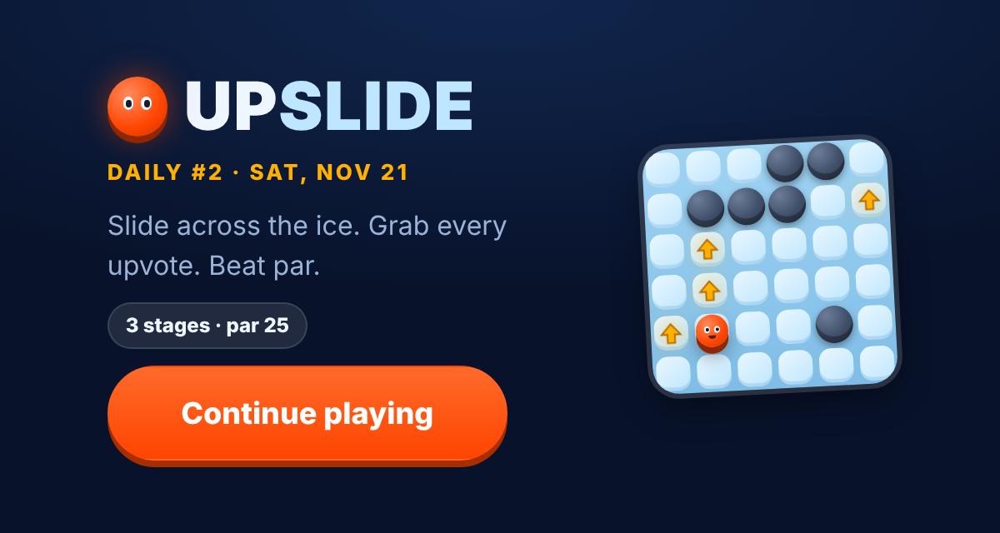
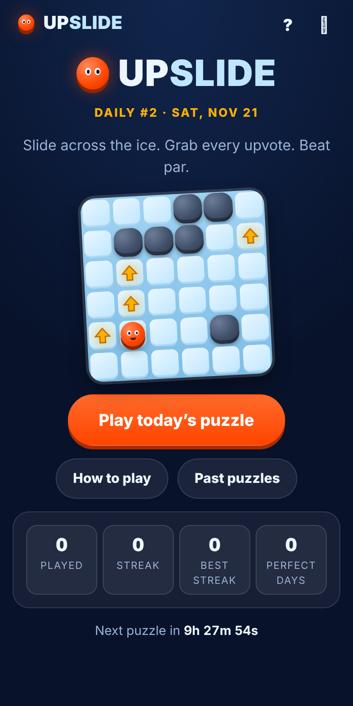

# Upslide — a daily ice-sliding puzzle for Reddit

Upslide is a daily puzzle game built with **Devvit Web** (React 19 + Vite + Hono) for Reddit's _Game of the Day_ 2026.

**Status: built and locally verified; not yet uploaded, published, or submitted.**
See [SUBMISSION.md](SUBMISSION.md) for the remaining user checklist.

Your puck is on ice. Once it moves, it doesn't stop until it hits a rock or a wall. Slide around the rink, **collect every upvote** and finish in as few moves as you can. Each day has three stages (**Warm-up → Tricky → Brutal**). Everyone on Reddit gets the same puzzle, and a new one appears every day at 00:00 UTC.

| Feed (inline)              | Home                   | Playing                | Results                      |
| -------------------------- | ---------------------- | ---------------------- | ---------------------------- |
|  |  |  |  |

## How to play

- **Swipe** the board, use the **arrow keys / WASD**, or tap the on-screen **d-pad**. The puck slides until something stops it.
- Passing over an **upvote** collects it. You don't need to stop on it.
- **Moss** (green tiles) stops the puck right where it lands.
- **Par** is the true minimum number of slides, found by breadth-first search (BFS). Finish at par for ★★★, up to par+2 for ★★, otherwise ★.
- **Undo** (`Z` / Backspace) and **Restart** (`R`) are allowed, but do not erase moves already counted.
- Finish the daily to see your score, the global leaderboard, a histogram of how everyone did, and your streak. Then copy an emoji result grid to share in the comments.

## Features

- **Deterministic daily challenge.** Every client and the server build the same 3 stages from the UTC date alone. No database or network is needed to load a puzzle.
- **Guaranteed solvable, with an exact par.** A BFS solver checks every generated stage and gives the optimal move count.
- **Replay-validated scoring.** The client sends its move log, not a score. The server replays it and calculates moves itself. Server elapsed time bounds timing claims, but automated play and actual active time remain unverified; this is not anti-cheat.
- **Scores, streaks and daily results.** Completing consecutive UTC dates builds a streak. Stores played / current streak / best streak / perfect days / total stars for each user in Redis. Keeps a per-day leaderboard (fewest moves, then fastest time) and an "over par" histogram.
- **Logged-out players can play.** Browser-local progress and stats survive reload in `localStorage`; authenticated rankings and stats use Devvit Redis.
- **Daily posts are automatic.** A scheduler job creates the new daily post at 00:01 UTC. A post is also created when the app is installed, and moderators get a subreddit menu item called _"Upslide: post today's puzzle"_.
- **Resumable runs and UTC rollover.** Elapsed time is saved periodically and pauses on Home or while the tab is hidden. Open sessions refresh at UTC midnight using a server-clock offset; an in-progress yesterday run can still finish.
- **Archive / practice mode.** Practice puzzles from the last 30 days, back to the puzzle epoch. Practice does not overwrite ranked results or affect streaks or leaderboards.
- **Mobile friendly.** Responsive portrait and landscape layouts have large tap targets and swipe input that only works on the board. The inline feed card uses no gestures, so it never traps scroll. Includes sound effects (can be muted) and supports reduced motion.

## How the daily challenge works

All of the logic is in [`src/shared/puzzle.ts`](src/shared/puzzle.ts). The client and the server share this file.

1. **Day key.** `dayKeyFromDate(now)` gives the UTC date as `YYYY-MM-DD`. Puzzle #1 is `2026-11-20`.
2. **Seed.** Each stage `i` hashes `"upslide|<dayKey>|<i>"` with a 32-bit FNV-1a-style hash to a seed for a `mulberry32` PRNG.
3. **Generate.** Using only that PRNG, the generator places rocks and moss on a 6×6 / 7×7 / 8×8 board and picks a start cell. It then simulates every slide the puck can make and drops upvotes on cells the puck actually passes over.
4. **Solve and grade.** A breadth-first search over `(position, collected-mask)` finds the shortest solution. The generator prefers layouts in the stage's par range (5–7, 8–11, 11–15), trying up to 400 candidates per stage.
5. **Same for everyone.** Output depends only on the UTC day key and stage, not the local timezone. Tests cover a year of solvable stages, fresh regeneration and UTC boundaries. An independent iterative-deepening search proves exact par for 60 days × all three stages.

## Project layout

```
devvit.json              Devvit app config (entrypoints, permissions, menu, trigger, scheduler)
src/shared/puzzle.ts     PRNG, generator, BFS solver, move/undo engine, replay validation, scoring
src/shared/api.ts        Types shared by client and server
src/shared/progress.ts   Streaks, validation, timing and local-progress helpers
src/shared/completion.ts Retry-safe completion orchestration
src/client/splash.*      Inline feed card (lightweight, opens the expanded game)
src/client/game.*        Full game (expanded view)
src/client/components/   Board, Results, Help, StatsGrid, Countdown, Logo
src/client/lib/          API client w/ offline fallback, localStorage, Web Audio SFX
src/server/index.ts      Hono server entry
src/server/routes/       /api/init, /api/board, /api/submit, menu, install trigger, daily scheduler
src/server/core/         Redis store (results, leaderboard, histogram, streaks) and post creation
tools/local-*.mjs        Local context/Redis harness and real-route tests
tools/LOCAL.md           Harness controls and limitations
```

## Run locally

Requirements: **Node.js ≥ 24** (see `.nvmrc`) and npm.
If using nvm, load it with `source ~/.nvm/nvm.sh`, then select the repository's Node version.

```bash
npm ci
npm run test:types   # TypeScript project build
npm run lint         # ESLint
npm run test:unit    # engine, progress, retry and real-route integration tests
npm run build        # builds dist/client (webview) and dist/server (index.cjs)
```

To play in a normal browser with the real API routes and fake local users:

```bash
npm run build
npm run dev:local
# open http://127.0.0.1:4173/game.html   (splash card: /splash.html)
```

The loopback-only harness serves `dist/client` and runs the **real Hono API routes
and store**, substituting only Devvit's server context and Redis with local stand-ins.
No Reddit credentials are needed. Rebuild after client edits; memory state resets
on harness restart. See [tools/LOCAL.md](tools/LOCAL.md) for fake users, clock
controls, leaderboard seeding, offline simulation and limitations. Redis expiry,
transactions and production concurrency are not modeled. Serving only the static
client without this API instead exercises offline mode, without a leaderboard.

### Scripts

| Script | Behavior |
| --- | --- |
| `build` | Vite/Devvit production build |
| `dev:local` | Built client and local API harness |
| `dev` | `devvit playtest` against a test subreddit |
| `test:types` | TypeScript project-reference build |
| `lint` | ESLint over source TypeScript/TSX |
| `test:unit` | Node test runner for source and harness tests |
| `login` | Authorize Devvit CLI with Reddit |
| `deploy` | Typecheck, lint, unit tests, then `devvit upload` |
| `launch` | Deploy, then `devvit publish` |
| `prettier` | Rewrite formatting across the repository |

Generated builds, tool output, logs and playtest screenshots should not be committed.
The original `docs/` images are illustrative; new playtest captures are separate.

## Deploy to Reddit (Devvit)

Create a Reddit developer account at <https://developers.reddit.com/> and a test
subreddit you moderate. All commands below are run by **you**, the developer;
none of these upload/install/publish steps have been performed for this project.

1. **Log in the CLI:** `npm run login` (runs `devvit login` and opens a browser to authorize).
2. **Check the app name.** Choose an available name in `devvit.json` if required by the CLI.
3. **Upload a version:** `npm run deploy` runs typecheck, lint, unit tests and `devvit upload`. Uploading is not publishing.
4. **Install/playtest:** run `npx devvit install YOUR_TEST_SUBREDDIT` to install the uploaded app, then `npm run dev -- YOUR_TEST_SUBREDDIT` to upload/install development updates and stream logs. Use a small test subreddit (the CLI specifies fewer than 200 members).
5. **Create a demo post:** open the subreddit and use the moderator menu **"Upslide: post today's puzzle"**. Installation also triggers post creation, so check for an existing post first. Verify inline/expanded gameplay, leaderboard and logged-in/out behavior on Reddit; the local harness cannot verify Reddit iframe or production Redis integration.
6. **Publication is separate:** `npm run launch` deploys and invokes `devvit publish`. Review Reddit's current publication/review requirements before using it.

The daily scheduler (`daily-post`, cron `1 0 * * *`) is configured to create a post at 00:01 UTC once installed. Posts load the current daily puzzle; archive practice is available in-game.

See [SUBMISSION.md](SUBMISSION.md) for the hackathon handoff and remaining checklist.

## License

BSD-3-Clause (inherited from the Devvit React template).
