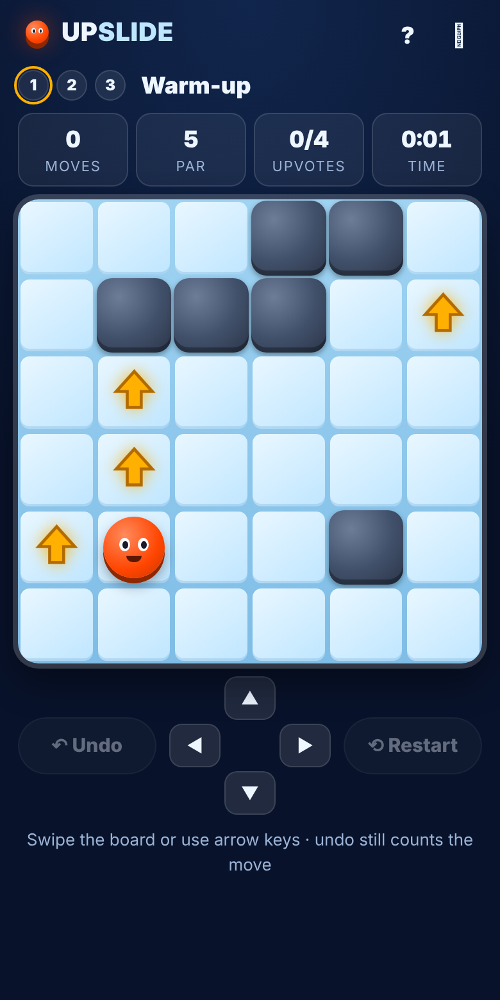
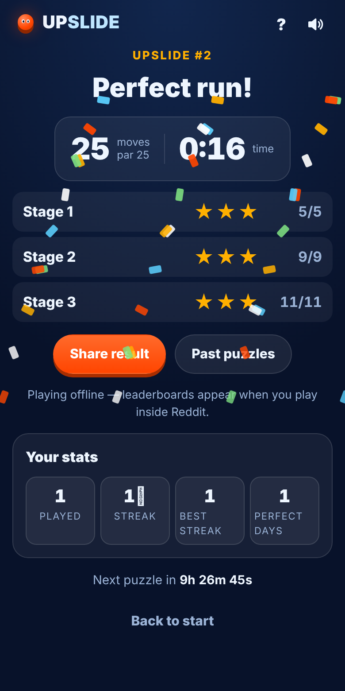

# Upslide — a daily ice-sliding puzzle for Reddit

Upslide is a daily puzzle game built with **Devvit Web** (React 19 + Vite + Hono) for Reddit's _Game of the Day_ 2026.

Your puck is on ice. Once it moves, it doesn't stop until it hits a rock or a wall. Slide around the rink, **collect every upvote** and finish in as few moves as you can. Each day has three stages (**Warm-up → Tricky → Brutal**). Everyone on Reddit gets the same puzzle, and a new one appears every day at 00:00 UTC.

| Feed (inline)              | Home                   | Playing                | Results                      |
| -------------------------- | ---------------------- | ---------------------- | ---------------------------- |
|  |  |  |  |

## How to play

- **Swipe** the board, use the **arrow keys / WASD**, or tap the on-screen **d-pad**. The puck slides until something stops it.
- Passing over an **upvote** collects it. You don't need to stop on it.
- **Moss** (green tiles) stops the puck right where it lands.
- **Par** is the true minimum number of moves, found by a solver. Finish at par for ★★★, par+2 for ★★, anything else for ★.
- **Undo** (`Z` / Backspace) and **Restart** (`R`) are allowed, but each undo counts as a move, so the score stays honest.
- Finish the daily to see your score, the global leaderboard, a histogram of how everyone did, and your streak. Then copy an emoji result grid to share in the comments.

## Features

- **Deterministic daily challenge.** Every client and the server build the same 3 stages from the UTC date alone. No database or network is needed to load a puzzle.
- **Guaranteed solvable, with an exact par.** A BFS solver checks every generated stage and gives the optimal move count.
- **Cheat-resistant scoring.** The client sends its move log, not a score. The server replays the log against the day's puzzle and calculates the moves itself.
- **Scores, streaks and daily results.** Stores played / current streak / best streak / perfect days / total stars for each user in Redis. Keeps a per-day leaderboard (fewest moves, then fastest time) and an "over par" histogram.
- **Logged-out players can play.** Progress and stats are kept in `localStorage`. After the player logs in, the finished run is submitted.
- **Daily posts are automatic.** A scheduler job creates the new daily post at 00:01 UTC. A post is also created when the app is installed, and moderators get a subreddit menu item called _"Upslide: post today's puzzle"_.
- **Resumable runs.** You can close the post in the middle of a stage and continue later. The timer pauses while the tab is hidden.
- **Archive / practice mode.** Replay any past day. Archive runs don't affect streaks or leaderboards.
- **Mobile friendly.** Layout is a single column with large tap targets and swipe input that only works on the board. The inline feed card uses no gestures, so it never traps scroll. Includes sound effects (can be muted) and supports reduced motion.

## How the daily challenge works

All of the logic is in [`src/shared/puzzle.ts`](src/shared/puzzle.ts). The client and the server share this file.

1. **Day key.** `dayKeyFromDate(now)` gives the UTC date as `YYYY-MM-DD`. Puzzle #1 is `2026-11-20`.
2. **Seed.** Each stage `i` hashes `"upslide|<dayKey>|<i>"` with a 32-bit FNV-1a-style hash to a seed for a `mulberry32` PRNG.
3. **Generate.** Using only that PRNG, the generator places rocks and moss on a 6×6 / 7×7 / 8×8 board and picks a start cell. It then simulates every slide the puck can make and drops upvotes on cells the puck actually passes over.
4. **Solve and grade.** A breadth-first search over the state `(position, collected-mask)` finds the shortest solution. The generator keeps the first layout whose optimal length falls inside the stage's par range (5–7, 8–11, 11–15). It tries up to 400 layouts per stage, which takes about 0.3 ms per day on a laptop.
5. **Same for everyone.** The output depends only on the date string, so everyone everywhere gets the same puzzle, and each date gives a different one. `src/shared/puzzle.test.ts` checks that 365 consecutive days are deterministic, solvable and within their par range.

## Project layout

```
devvit.json              Devvit app config (entrypoints, permissions, menu, trigger, scheduler)
src/shared/puzzle.ts     PRNG, generator, BFS solver, move/undo engine, replay validation, scoring
src/shared/api.ts        Types shared by client and server
src/client/splash.*      Inline feed card (lightweight, opens the expanded game)
src/client/game.*        Full game (expanded view)
src/client/components/   Board, Results, Help, StatsGrid, Countdown, Logo
src/client/lib/          API client w/ offline fallback, localStorage, Web Audio SFX
src/server/index.ts      Hono server entry
src/server/routes/       /api/init, /api/board, /api/submit, menu, install trigger, daily scheduler
src/server/core/         Redis store (results, leaderboard, histogram, streaks) and post creation
```

## Run locally

Requirements: **Node.js ≥ 24** (see `.nvmrc`) and npm.

```bash
npm install
npm run test:types   # TypeScript project build
npm run lint         # ESLint
npm run test:unit    # puzzle engine tests (365 days of generated puzzles)
npm run build        # builds dist/client (webview) and dist/server (index.cjs)
```

To play the client in a normal browser, without Reddit, serve the built webview:

```bash
npx vite build && npx serve dist/client   # or: cd dist/client && python3 -m http.server 4173
# open http://localhost:4173/game.html   (splash card: /splash.html)
```

Outside Reddit the game runs in **offline mode**. It is the same daily puzzle with local streaks and stats, but it has no leaderboard.

## Deploy to Reddit (Devvit)

You need a Reddit account and a subreddit you moderate to test in. All of these commands are run by **you**, the developer.

1. **Log in the CLI:** `npm run login` (runs `devvit login` and opens a browser to authorize).
2. **Rename the app if needed.** App names are global on Reddit. If `upslide-game` is already taken, change `"name"` in `devvit.json` to a unique name with up to 16 characters, made of lowercase letters, digits and dashes.
3. **Playtest:** `npm run dev`. This runs `devvit playtest`, uploads a dev build, installs it on a private test subreddit, and live-reloads on save. Open the subreddit, then use the subreddit menu **"Upslide: post today's puzzle"** to create a post. A post is also created automatically on install.
4. **Upload a version:** `npm run deploy` (runs type-check, lint and `devvit upload`).
5. **Publish:** `npm run launch` (runs `devvit publish`) submits the app for Reddit review so it can be installed on other subreddits.

The daily scheduler (`daily-post`, cron `1 0 * * *`) then posts each new puzzle automatically. Every post shows that day's puzzle, and older posts stay playable as practice.

### Hackathon submission checklist

- [ ] Public repo (this one)
- [ ] App uploaded with `npm run deploy` and installed in a test subreddit
- [ ] Link to a live Upslide post on Reddit
- [ ] Devpost write-up (copy from the sections above)

## License

BSD-3-Clause (inherited from the Devvit React template).
